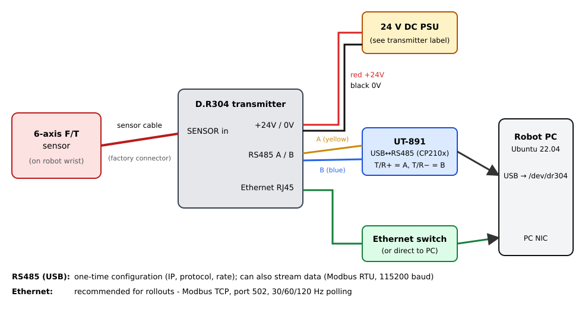

# D.R304 Six-Axis F/T Sensor — Wiring & Linux Setup Guide

**For:** a Linux PC (developed and tested on Ubuntu 22.04) used for robot data collection and rollouts
**Package:** `dr304-ft` (Python, `import dr304`)
**Version:** 0.2.0 — 2026-10-20 · **Hardware-verified** on one D.R304 unit (see §0 and Appendix B)

---

## 0. Read this first

* The vendor software is **Windows-only** (LabVIEW). It says it does not support Linux, and its manuals
  never describe the communication protocol. The `dr304` package in this folder replaces the vendor
  software on Linux. We worked out the protocol by extracting the vendor's own programs
  (details in Appendix B).
* **Status of the package on real hardware** (our unit, 2026-10-20): configuration read-back/write, live
  force/torque, IP-address encoding and CSV recording all work. **Over Ethernet (Modbus TCP) it records at
  120.0 Hz with 0 errors, 0 overruns and 0.3 ms period jitter** (1201 samples in 10 s). Over USB-RS485 it is exact at
  30 Hz and tops out at ≈ 55 Hz. Do the physical checks in §6 (gravity, axes, torque scale) before trusting numbers
  for training data.
* You will **not** need the Windows GUI, the USB license dongle, or the Chinese-locale setup. The only
  exception is a fallback case covered in Troubleshooting.

### What is in the box

| Item | Purpose |
|---|---|
| Six-axis F/T sensor (with cable) | the measuring element; mounts on the wrist |
| **D.R304 transmitter** (grey aluminium box) | amplifies and digitises the 6 bridges; RS485 + Ethernet outputs |
| **UT-891 USB↔RS485/422 converter** + green 5-pin terminal adapter | PC ↔ transmitter serial link (configuration, or data) |
| 24 V DC power supply / leads | powers the transmitter (and through it the sensor) |
| Ethernet cable | data link for rollouts |
| USB stick + red USB dongle | Windows software + its license key — *not needed on Linux* |

*(The vendor's demo video shows the same set-up: sensor, transmitter, USB-485 cable, 24 V supply and Ethernet.)*

---

## 1. How it fits together



There are two links from the transmitter to the PC. Both speak Modbus, and you can use either or both:

| Link | Protocol | Use it for | Rate |
|---|---|---|---|
| **RS485 via UT-891 (USB)** | Modbus RTU, slave id 1 | **first-time configuration** (IP address, Ethernet protocol, sampling rate); fine for **30 Hz** logging | **measured: 30 Hz exact, ≈ 55 Hz max** (the transmitter takes ≈ 11 ms to answer each request and needs 4 ms of quiet before the next) |
| **Ethernet (RJ45)** | Modbus TCP, port 502 | **needed for 60 / 120 Hz rollouts** — longer cables, galvanic isolation | **measured: 120.0 Hz, 0 errors, 0.3 ms jitter** |

> The vendor GUI uses a third mode called "DAS_TCP" (Ethernet protocol = 2). We set the transmitter to
> **Ethernet protocol = 1 (Modbus TCP)** instead, because that protocol is fully understood. Switching it back
> to 2 is one command if someone ever wants the vendor GUI again.

---

## 2. Safety and handling

1. **Power off** (unplug the 24 V supply) whenever you change wiring.
2. **24 V DC only, check polarity** before switching on. Reversed or excessive voltage can destroy the transmitter.
3. **Do not overload the sensor.** Check its rated Fx/Fy/Fz/Mx/My/Mz on the sensor label. During teleop and
   rollouts, add a software limit in your controller (for example, stop if |F| > 80 % of the rating).
4. Route the sensor cable with **strain relief** along the arm. A cable tugged by the robot shows up as fake force and torque.
5. Mount the sensor with the bolts and torque its datasheet specifies, on flat, clean flanges. Uneven clamping adds offsets.
6. **Keep the transmitter away from motor drives and power cables.** The bridge signals are millivolts.

---

## 3. Wiring

### 3.1 Sensor → transmitter

Plug the sensor's cable into the transmitter's **sensor input** connector, aligning the key, and tighten the
locking ring. The six-axis sensor ships pre-terminated, so you don't wire individual conductors.

*Only if your sensor arrived with flying leads* (an older or alternative cable), the vendor's colour convention for each
bridge is **red = EX+, black = EX−, green = SG+, white = SG−**. Follow the labels on the transmitter's
terminals, and ask the vendor for the channel order before wiring six bridges by hand.

### 3.2 Power

Connect the 24 V supply to the transmitter's power terminals: **red → +24 V, black → 0 V (GND)**. Check the labels
on your unit's terminal block, since they take precedence over the colour convention. Leave the supply switched off for now.

### 3.3 RS485 → UT-891 USB adapter

Screw the green terminal adapter onto the UT-891's DB9 connector and wire:

| Transmitter wire | Adapter terminal | Note |
|---|---|---|
| **RS485 A** (yellow) | **T/R+** (1st terminal) | |
| **RS485 B** (blue) | **T/R−** (2nd terminal) | |
| — | RXD+, RXD−, GND | leave empty (RS422 only). GND *may* be tied to transmitter 0 V on long runs |

*(UT-891 terminal adapter: A goes to T/R+, B goes to T/R-. See the photo in the vendor manual.)*

> If the link does not work, swapping A and B is harmless. Many manufacturers label them the other way round.

*(The UT-891 converter has a Silicon Labs CP210x inside.)*

### 3.4 Ethernet

Plug a CAT5e/6 cable from the transmitter's RJ45 into **either**

* the PC's wired NIC directly, **or**
* the same switch as the robot PC. The vendor notes that on a switch or router, both devices must be on ordinary
  LAN ports, not the uplink/WAN port.

### 3.5 Power on

Switch on the 24 V supply. The transmitter should light up. Let it warm up for **~15 minutes** before
recording data you care about. Strain-gauge sensors drift while they warm up.

---

## 4. PC setup (Ubuntu 22.04) — once

```bash
git clone <your repository URL> dr304-ft && cd dr304-ft
conda activate <your-env>            # or any venv / python3 >= 3.9 you use for data collection
bash scripts/install.sh              # pip install -e . , udev rule, dialout group
```

(To only use the library, with no udev rule: `pip install .` or `pip install git+<your repository URL>`.)

The script does three things:

1. `pip install -e .`. This installs the `dr304` Python package and the `dr304` command; `pyserial` is the only dependency.
2. Installs `udev/99-dr304.rules`. The UT-891 (USB id `10c4:ea60`) then always appears as **`/dev/dr304`**,
   in low-latency mode, and ModemManager stops probing it.
   *If the PC has other USB-serial devices, the UT-891's `ttyUSBn` number is not predictable. Always use `/dev/dr304`.
   If you have several CP210x adapters, add `ATTRS{serial}=="..."` to the rule (see its comments).*
3. Adds you to the `dialout` group if needed (log out and back in once).

No driver install is needed. The CP210x driver is built into the Ubuntu kernel (`lsmod | grep cp210x`).

Check:

```bash
dr304 ports
# /dev/ttyUSB0  10c4:ea60  CP2102 USB to UART Bridge Controller   <-- CP210x (UT-891 USB-RS485?)
ls -l /dev/dr304
```

---

## 5. Configure the transmitter (over RS485, once)

### 5.1 First contact

```bash
dr304 --serial /dev/dr304 --baud auto info
```

`--baud auto` tries 115200, 19200, 9600, … (the vendor says the factory default is 19200; their
screenshots show 115200). You should see something like:

```
# found device at 115200 baud
device       : DR304(/dev/dr304, unit=1)
word order   : high word first
units        : N / N.m   decimals 2/3
ethernet     : 192.168.1.100:502
  filter_depth           [1548] = 8
  force_unit             [1556] = 5          (N)
  force_decimals         [1558] = 2
  torque_decimals        [1560] = 3
  picking_rate           [1562] = 4          (100)
  rs485_protocol         [1588] = 1          (modbus-rtu)
  rs485_baud             [1590] = 6          (115200)
  rs485_format           [1592] = 0          (n80, high word first)
  eth_protocol           [1604] = 1          (modbus-tcp)
  ...
raw values   : [77.98, -28.72, 32.59, -0.99, -1.615, 3.037]
wrench       : fx=  +77.940  fy=  -28.700  fz=  +32.580  mx=   -0.990  my=   -1.615  mz=   +3.036
mV/V (raw)   : [12981, 33501, -13531, 21443, 18758, 644]
```

This is the real output from our unit (the force values are non-zero because the sensor was not tared and
had a load on it). Yours should look the same apart from the numbers. Note that our unit already had
`rs485_protocol = 1`, `rs485_baud = 6` (115200) and `eth_protocol = 1` from the factory/previous use, and its IP
was **192.168.1.100**. §5.2 explains why that address (plus a matching address on the PC's USB-Ethernet NIC) is what we use.

**Write the output down (or save it: `dr304 ... info > dr304_factory_settings.txt`).** It is your record of the
factory configuration.

If nothing answers, see Troubleshooting (§9).

### 5.2 Choose a network address — know which NIC the sensor is on

**The sensor's IP must be reachable through the NIC its cable actually ends up on.** The transmitter has a fixed IP (it
cannot use DHCP), so the PC needs an address in the same subnet on the NIC that is cabled to it. Example from the
lab where this was developed: the PC has two NICs, one cabled directly to the robot (`192.168.100.1/24`) and a USB-Ethernet
adapter on the office network (`10.x.x.x`, DHCP); the sensor was plugged into the office hub. We first gave the sensor an
address in the robot subnet; pings left through the robot NIC, never reached the hub, and failed with *Destination
Host Unreachable*, and `tcpdump` on the robot NIC showed nothing from the sensor. **If you cannot reach the sensor, check
which NIC its cable goes to before anything else.** `ip route get <sensor-ip>` shows which NIC the PC will use.

Typical recipe: keep the factory address **192.168.1.100** and give the PC's NIC a second address in that subnet:

```bash
ping -c 3 192.168.1.100                  # before the sensor is connected: must get NO reply (address is free)
sudo ip addr add 192.168.1.10/24 dev <nic>                # until reboot
# permanent (re-applies without dropping the connection):
sudo nmcli connection modify <connection-name> +ipv4.addresses 192.168.1.10/24
sudo nmcli device reapply <nic>
# undo:
sudo nmcli connection modify <connection-name> -ipv4.addresses 192.168.1.10/24 && sudo nmcli device reapply <nic>
```

(`nmcli -t -f NAME,DEVICE connection show --active` lists the connection names. The DHCP address, default route and
internet access of that NIC are unaffected.) Never give two NICs addresses in the same subnet. On a shared hub the
sensor is visible to other machines (it has no authentication). If that is not acceptable, use a **dedicated link**: a
spare NIC or USB-Ethernet adapter with a cable straight to the transmitter, for example PC `192.168.2.1/24`, sensor
`192.168.2.100` (set with `set-ip`):

```bash
nmcli con add type ethernet ifname <nic> con-name ft-sensor ipv4.method manual ipv4.addresses 192.168.2.1/24
nmcli con up ft-sensor
```

**No Ethernet at all?** The USB-RS485 link needs no network setup and is exact at 30 Hz (≈ 55 Hz maximum, §7.4).

The rest of this guide uses **192.168.1.100**. Substitute your choice.

### 5.3 Write the settings

```bash
# Ethernet protocol 1 = Modbus TCP (what the Python package uses)
dr304 --serial /dev/dr304 set eth_protocol 1

# fast sampling inside the transmitter (800 Hz ADC) so 120 Hz polling always gets fresh data.
# Our unit shipped with picking_rate 4 = 100 Hz, which is too slow for 120 Hz logging.
dr304 --serial /dev/dr304 set picking_rate 7

# IP address + port, then save everything to flash (skip if the unit already has the address you want)
dr304 --serial /dev/dr304 set-ip 192.168.1.100 --port 502
```

```bash
# remove 50 Hz mains pickup (measured: Fy noise 2.8 N -> 0.05 N at 30 Hz logging); only valid with picking_rate 7
dr304 --serial /dev/dr304 set filter_depth 16 --save
```

`set-ip` and `--save` write to flash (command 40 to register 2592). Then:

**Power the transmitter OFF for 10 seconds, then ON.** Network settings only apply after a power cycle.

Optional, for **lowest latency** (the vendor's "high response speed" recipe). This **undoes** the 50 Hz fix above, so only
use it if you need fast contact transients and will filter in software:

```bash
dr304 --serial /dev/dr304 set stability_condition 0
dr304 --serial /dev/dr304 set shock_filter 0
dr304 --serial /dev/dr304 set filter_depth 1 --save
```

The factory filter (`filter_depth` 8 here) does not remove 50 Hz mains pickup; 16 does (see §9). The filter adds ≈ 10 ms of delay
and attenuates content above ≈ 25 Hz, which is irrelevant for 30 Hz logging.

### 5.4 Verify Ethernet

```bash
ping -c 3 192.168.1.100
dr304 --tcp 192.168.1.100 info
dr304 --tcp 192.168.1.100 bench          # expect several hundred Hz max
dr304 --tcp 192.168.1.100 read --tare    # live values; Ctrl-C to quit
```

From here on, the USB-RS485 cable can stay unplugged. Keep it with the sensor for reconfiguration.

---

## 6. Bring-up checklist (first time on real hardware)

The protocol was reverse-engineered, so check these once and tick them off:

| # | Check | How | Expected |
|---|---|---|---|
| 1 | Settings read back sensibly | `dr304 --serial /dev/dr304 info` | `force_unit` 1–6, decimals 0–5, `rs485_baud` 0–6, IP looks like `192.168.x.y`. **Done ✔ (our unit)** |
| 2 | IP encoding correct | `info` shows the IP the vendor GUI showed (factory `192.168.1.100` or `192.168.2.100`) | if it shows something odd like `0.192.168.1`, stop and report — do **not** use `set-ip`. **Done ✔: registers read `192168 / 1100 / 502` = 192.168.1.100:502** |
| 3 | Gravity test (Fz) | sensor Z axis vertical, `read --tare`, put a known mass *m* on it | Fz changes by ≈ m × 9.81 N (sign depends on the sensor's axis convention) |
| 4 | Axes and signs | push along +X, +Y; twist about Z | the matching channel responds; note the signs for your robot frame |
| 5 | Torque scale | hang mass *m* at lever arm *r* | Mx or My ≈ m·9.81·r N·m |
| 6 | Rate | `dr304 --tcp IP record -r 120 -d 10 -o test.csv` | prints ≈ 120 Hz, `errors=0`. **Done ✔. Ethernet: 120.0 Hz, 0 errors, 0 overruns, period 8.33 ± 0.30 ms. RS485: 30 Hz → 30.0 Hz; 60 Hz → 55.8 Hz (serial limit)** |
| 7 | Unloaded noise | `read` with nothing attached | a few counts of the last decimal |

The live values arrive as IEEE-754 floats already in the device's physical unit (`force_unit`, N here), so
there is no scaling factor to get wrong. If check 3 or 5 is off by a fixed factor (for example 9.81), the
transmitter's `force_unit` is probably kg rather than N: look at the `units` line of `info`.

---

## 7. Using it from Python

### 7.0 Point the SDK at your sensor once

Every call below accepts a URI, but you can leave it out and set it once per machine:

```bash
export DR304_URI=serial:///dev/dr304          # or tcp://192.168.1.100
# or put {"uri": "serial:///dev/dr304", "rate_hz": 30} in ./sensor.json or ~/.config/dr304/sensor.json
dr304 check                                   # connects, reads, streams for 3 s, reports
```

### 7.1 Simplest

```python
import dr304

with dr304.connect("tcp://192.168.1.100") as s:      # or "serial:///dev/dr304", or no argument
    w = s.read()                                       # Wrench(fx, fy, fz, mx, my, mz), N and N.m
    print(w.fz, w.force, w.torque)
```

### 7.2 Background stream for rollouts (recommended)

```python
import dr304

with dr304.open_stream(rate_hz=30, tare=1.0) as ft:   # URI from $DR304_URI / sensor.json; tare = gripper still
    for ep in range(num_episodes):
        ft.start_recording(f"data/ep{ep:03d}/ft.csv", meta={"episode": ep, "task": task})
        while not done:
            s = ft.latest()       # newest sample (non-blocking): s.wrench, s.t_wall, s.t_mono, s.seq
            obs["ft"] = list(s.wrench)
            ...                   # cameras, policy, robot command
        ft.stop_recording()
```

The longer form, `FTStream(DR304.tcp("192.168.1.100"), rate_hz=120).start()`, does the same and is what `open_stream` calls.

Key API (all thread-safe):

| Call | What it does |
|---|---|
| `FTStream(sensor, rate_hz=120, buffer_seconds=30)` | polls in a daemon thread at a fixed rate; keeps the last 30 s in RAM |
| `start()` / `stop()` / `with FTStream(...) as ft:` | connect + start, or stop + disconnect |
| `latest()` | newest `Sample(seq, t_wall, t_mono, wrench)` |
| `wait_next(timeout)` | block until the next sample (for event-driven code) |
| `window(t0, t1, clock="mono")` | all buffered samples between two times (`time.monotonic()` by default, or `"wall"` = `time.time()`) |
| `since(seq)` | every sample after `seq`. Use it for a lossless consumer running slower than 120 Hz |
| `mean(seconds)` | average of the last N seconds |
| `tare(seconds)` / `clear_tare()` / `bias` | software zero (the device's own zero is left untouched) |
| `start_recording(path, meta)` / `stop_recording()` | write every sample to CSV plus a `path.json` sidecar |
| `stats` | `samples`, `errors`, `overruns`, `retries`, `last_error` |

The stream retries short glitches, and after 50 consecutive errors it reconnects by itself.

### 7.3 Recorded files

`ft.csv`:

```
seq,t_wall,t_mono,fx,fy,fz,mx,my,mz
1,1792475745.649171,2675960.636007,0.75,-2.23,-0.09,-0.020,-0.034,0.019
```

* `t_wall` = `time.time()` (UNIX seconds) and `t_mono` = `time.monotonic()`, both taken when the reply arrives.
  Align with cameras and robot logs by stamping those with the same clocks. `t_mono` is immune to NTP jumps.
* Values are **after tare**, in the units in the sidecar (`N` / `N.m` by default).
* `ft.csv.json` holds the rate, units, decimals, the subtracted bias (so raw = value + bias), the device's internal
  sampling rate, your `meta`, the sample count and start/stop times.

Command-line recording without Python:

```bash
dr304 --tcp 192.168.1.100 record -r 120 --tare -o run1.csv            # until Ctrl-C
dr304 --tcp 192.168.1.100 record -r 60 -d 30 -o run2.csv --note "peg insertion"
```

### 7.4 Rates: 30 / 60 / 120 Hz

* The transmitter's ADC runs at `picking_rate` (set to 7 = 800 Hz in §5.3; our unit shipped at 4 = 100 Hz). The
  package polls the latest value at your `rate_hz`. Keep `picking_rate` ≥ 5 (200 Hz) for 120 Hz polling.
* **Over RS485 the practical limit is ≈ 55 reads/s** (measured). The transmitter takes ≈ 11 ms to answer a request,
  the reply itself takes 2.5 ms on the wire, and it ignores any request that follows its reply by less than ~2 ms
  (the package waits 4 ms). So **30 Hz is exact; 60 Hz runs at ≈ 56 Hz** and `FTStream` issues a `RuntimeWarning`;
  120 Hz is not possible on the serial link. **Use Ethernet for 60 / 120 Hz** (measured: 120.0 Hz, 0 errors).
* Do not hammer the serial link faster than it can answer: a request sent too soon is ignored, and the
  transmitter then stays deaf until the line has been quiet for ≈ 100 ms. The package handles this itself (it waits and
  retries once; `ft.stats["retries"]` counts these), but your own scripts using raw Modbus tools must do the same.
* Ask for the rate you'll actually log. Higher is fine (try 250–500 Hz over Ethernet with `dr304 bench`), but
  keep the CSVs manageable.

### 7.5 Practical notes

* Use **one `FTStream` per sensor, in one process**. If several processes need F/T, let one own the sensor and
  share the data (ROS topic, ZMQ, shared memory). Small transmitters accept only a few TCP clients.
* **Re-tare** before each episode, or whenever the gripper or tool changes. Tare with the robot in a fixed pose.
  The tool's weight rotates with the wrist, so a tare is only exact in the pose where it was taken.
* `ModbusError` is raised (from `DR304.read`) or counted in `ft.stats` (stream) when the link fails.
* A simulator is included for developing without hardware:
  `dr304 sim` → then `dr304 --tcp 127.0.0.1:5020 read`, or `FTStream(DR304.tcp("127.0.0.1", 5020))`.
* Tests: `pip install -e '.[test]' && pytest tests` (21 tests: Modbus TCP and RTU, float32 decoding, word order,
  RTU gap/retry behaviour, 30/60/120 Hz recording against the simulator).

---

## 8. Command reference

```
dr304 ports                                   list serial ports, flags the CP210x
dr304 [--uri URI | --tcp IP[:PORT] | --serial DEV [--baud N|auto]] [--profile FILE] [--unit 1] <command>
      (with none of those: $DR304_URI, then sensor.json / ~/.config/dr304/sensor.json)
    check  [-r HZ] [-s SEC]                   self test: connect, read config, stream, report rate/errors
    info                                      all parameters + one sample
    read   [-r HZ] [--tare]                   live values
    record [-r HZ] [-o FILE] [-d SEC] [--tare] [--note TXT]
    bench  [-s SEC]                           max poll rate / latency
    set NAME VALUE [--save] [-y]              write one parameter (names from `info`)
    set-ip IP [--port 502] [-y]               write IP/port and save to flash
    das-dump [-s SEC] [-o FILE]               raw capture of vendor DAS_TCP mode (experimental)
dr304 sim [--port 5020] [--pty]               simulated sensor
```

Every write asks for confirmation unless you pass `-y`. Settings become permanent only with `--save` (or `set-ip`),
and need a **10 s power cycle**.

---

## 9. Troubleshooting

| Symptom | Cause / fix |
|---|---|
| `/dev/dr304` missing | `dr304 ports`; is the UT-891 listed as `10c4:ea60`? Re-plug, `sudo udevadm trigger`. Try another USB port |
| `Permission denied: /dev/dr304` | not in `dialout` — `sudo usermod -aG dialout $USER`, log out and in |
| `no D.R304 answered … at any baud rate` | The package version before 2026-10-20 failed here even with a working sensor (it mis-parsed the live data and then hid the error). Update and retry. Otherwise: (1) swap A/B; (2) check 24 V is on; (3) try `--unit 0` … `--unit 5` in case the machine code was changed; (4) the 485 protocol may be set to **AutoSend** (2), which doesn't answer polls — see next row |
| RS485 is in AutoSend mode / still nothing | Fall back once to the vendor **Windows** debug tool (`DR304/调试工具TestTool/D.R304调试工具.exe`; install the CP210x driver from `485驱动485drive/891.zip`). Set *485 Communication protocol* = 1, *485 baud rate* = 6, *Ethernet protocol* = 1, set the IP, **Save**, power-cycle |
| `ping` fails | **wrong NIC** — the sensor's cable may end up on a different NIC than the subnet you gave it (we lost an hour to this, see §5.2; `ip route get <sensor-ip>` shows which NIC the PC will use, `sudo tcpdump -i <nic> -e arp` shows whether the sensor is on it); different subnets; IP clash (unplug the sensor and ping again — if something still answers, the IP is taken); not power-cycled after `set-ip` |
| ping OK, but `dr304 --tcp` times out | Ethernet protocol is still 2 (DAS_TCP) → `dr304 --serial /dev/dr304 set eth_protocol 1 --save`, power-cycle. Or another program (vendor GUI) holds the connection |
| `implausible decimals` on connect | word order is different from what we assumed: pass `DR304.tcp(ip, low_word_first=True)` |
| Every second request times out / `timeout: got 0/3 bytes` | A custom script is sending requests too fast (see §7.4). Leave ≥ 4 ms of silence after each reply, and ≥ 100 ms after a failure |
| Values off by a constant factor | check `force_unit` in `info` (kg vs N, 1 kgf = 9.81 N) |
| Values drift slowly | warm-up (15 min), temperature changes, cable strain; re-tare between episodes |
| 50 Hz noise / noisy values | **Fix: `filter_depth 16` with `picking_rate 7`** (§5.3). Our unit, unloaded with a gripper mounted, showed a clean 50 Hz (mains-frequency) tone of ≈ 3 N on Fy/Fz that aliased to 10 Hz in 30 Hz logging (Fy std 2.8 N, 8 N peak-to-peak). It was **not** the gripper (identical with it on or off). With `filter_depth 16` (a 16-sample = 20 ms average at the 800 Hz ADC rate = one 50 Hz period) the std fell to 0.05 N on Fy and 0.001 N·m on torques. The depth is only right for 800 Hz; change both together. Other noise: raise `filter_depth` further, or filter in software |
| `overruns` increasing | the PC is busy; lower `rate_hz`, or run the stream in a process that isn't saturating the CPU or GIL |
| Several F/T sensors | each needs a different IP **and** a different `eth_address` (it sets the MAC) |

Restore factory settings: in the vendor tool, *Factory reset*. (Over Modbus it is command 30 then 40 on register 2592.
This is deliberately not exposed in the CLI.)

---

## Appendix A — Register map (Modbus holding registers)

Every value occupies **2 registers**, high word first by default (the tens digit of register 1592 = 1 means low word first). Parameters and the mV/V block are signed 32-bit integers; the live force/torque block is **IEEE-754 float32**.
Read with function 0x03 and write with function 0x10. Slave id = machine code (default 1).

| Address | Name | Meaning |
|---|---|---|
| **1024–1035** (0x0400) | **Fx Fy Fz Mx My Mz** | **float32**, already in `force_unit` / `force_unit·m` (verified on hardware). Decimals only set the device's rounding |
| 2640–2651 (0x0A50) | mV/V ×6 | raw bridge outputs, signed int32 (diagnostics) |
| 1538 | manual zero range | |
| 1540 | zero tracking range | |
| 1542 | clear mode | units digit: power-on zero; tens digit: zero tracking |
| 1544 | stability condition | 0–1000 d |
| 1546 | shock (vibration) filter | 0–3 |
| 1548 | digital filter depth | 0–1200 |
| 1556 | force unit | 1 t, 2 kg, 3 g, 4 kN, 5 N, 6 lb |
| 1558 / 1560 | force / torque decimals | 0–5 |
| 1562 | picking (ADC) rate | 0–7 = 6.25 / 12.5 / 25 / 50 / 100 / 200 / 400 / 800 Hz |
| 1588 | RS485 protocol | 0 off, 1 Modbus RTU, 2 AutoSend |
| 1590 | RS485 baud | 0–6 = 2400 … 115200 |
| 1592 | RS485 data format | units: n80 n81 e81 e82 o81 o82 (serial framing, **not** the data type); tens: word order. Ours reads 0 |
| 1594 | packet interval | ×0.001 s |
| 1596 | RS485 machine code | 0–255 |
| 1598 / 1600 / 1602 | IP / IP / port | `ip0·1000+ip1`, `ip2·1000+ip3`, port |
| 1604 | Ethernet protocol | 0 off, 1 Modbus TCP, 2 DAS_TCP |
| 1612 | Ethernet address | affects the MAC; unique per sensor |
| 1614 | DAS_TCP send interval | ×0.001 s |
| 1628…1728 (step 20) | K1…K6 | factory correction factors — do not touch |
| 2592 (0x0A20) | command | write 40 = save to flash; 30 = factory reset (then 40) |

## Appendix B — Where this came from and how sure we are

The vendor docs (`D.R304高速采集系统使用说明new.doc`, the debugging guide `.docx`, the PDF inside the installer,
and the video) only cover the Windows GUI. We recovered the protocol by unpacking the installer
(`bin/dp/data.cab`), extracting the LabVIEW VIs from both executables (with *pylabview*), and reading the
constants the debug tool uses for its Modbus requests and the GUI uses for its TCP parser.

| Fact | Evidence | Confidence |
|---|---|---|
| Parameter addresses 1538–1728, all "long" (int32) | parameter table embedded in the debug tool; matches the screenshots | high |
| Live F/T = function 0x03, start 0x0400, 12 registers, six 4-byte values at byte offsets 3, 7, 11, 15, 19, 23 | literal request bytes `03 04 00 00 0C` in the debug tool; **confirmed on hardware** | confirmed |
| Live values are **float32**, not scaled int32 (our first reading of the vendor code was wrong here) | **hardware**: reply `42 9c 8f 5c …` = 78.28 N and the values vary with load. The decimals registers are only display precision | confirmed |
| Word order from register 1592 tens digit | the tool reads 1592 and divides by 10; our unit reads 0 and the data decode correctly high-word-first | confirmed for "high first"; "low first" untested |
| Parameter table 1538–1728 (int32) | readings from hardware are sensible (unit 5 = N, decimals 2/3, rate 4, baud 6, protocol 1) | confirmed |
| IP = 1598/1600/1602 as `a·1000+b` | **hardware**: read `192168 / 1100 / 502` = 192.168.1.100:502; `set-ip` to .100.150 and back to .1.100 took effect after a power cycle | confirmed (read and write) |
| mV/V block at 0x0A50, int32 | hardware: six plausible signed values | confirmed |
| Timing: ≈ 11 ms reply latency; request < 2 ms after a reply is ignored; deaf until ≈ 100 ms silence | measured on hardware (see `docs/PROTOCOL_NOTES.md`) | confirmed |
| Save = write 40 to 2592 | settings (IP, picking_rate 7) survived a power cycle | confirmed |
| Modbus TCP serves the same map | **hardware**: `info`, `read` and 120 Hz `record` over TCP port 502 work | confirmed |
| DAS_TCP: 71-byte ASCII frames, 7-char ints at offsets 25…60 | GUI parser constants | medium; header not decoded → `das_tcp.py` is experimental |

## Appendix C — Files

```
dr304-ft/                       the repository
├── README.md                   start here
├── docs/DR304_FT_Sensor_Setup_Guide.{md,pdf}   this guide
├── docs/API.md                 Python API and CSV format reference
├── docs/PROTOCOL_NOTES.md      how the protocol was recovered, measurements
├── src/dr304/                  sensor.py  stream.py  profile.py  modbus.py  registers.py  cli.py  sim.py  das_tcp.py
├── examples/                   basic_read.py  rollout_logging.py  sensor.example.json
├── tests/test_dr304.py
├── udev/99-dr304.rules         scripts/install.sh
└── pyproject.toml
```
